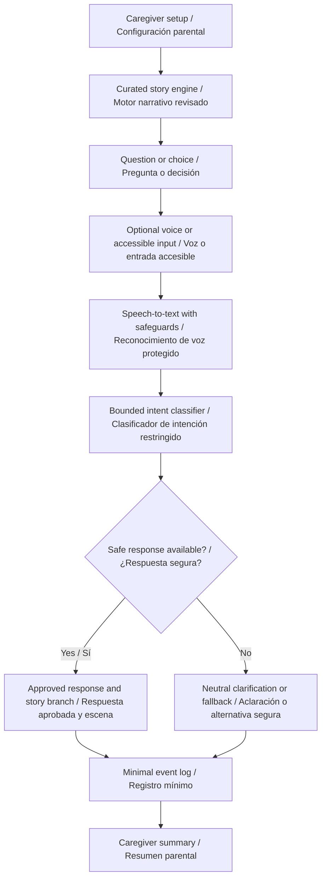

# Architecture / Arquitectura

## Conceptual pipeline / Flujo conceptual



## Proposed components / Componentes propuestos
| Component | Responsibility / Responsabilidad |
|---|---|
| Story editor | Scripted scenes, branching paths, reviewed learning objectives / Escenas, rutas y objetivos revisados |
| Client player | Playback, microphone permission, captions and accessibility / Reproducción, permisos y accesibilidad |
| Dialogue controller | Constrained intent mapping and safe responses / Intenciones limitadas y respuestas seguras |
| Session state | Short-lived context; opt-in limited narrative memory / Contexto temporal y memoria narrativa limitada opcional |
| Caregiver service | Consent, controls, summaries and deletion / Consentimiento, controles, resúmenes y borrado |
| Safety service | Content validation, escalation and fail-closed behavior / Validación y respuesta segura ante fallos |

## Design decisions / Decisiones
- Start with original, human-authored scenes and constrained dialogue; no unrestricted child-facing chatbot.
- Process audio ephemerally where feasible; avoid raw audio retention by default.
- Separate child and caregiver interfaces; caregiver authentication and permissions.
- Do not infer diagnoses, emotional states or sensitive traits from voice.
- Minimize identifiers, encrypt data, limit retention, and log access to sensitive records.
- Offline fallback and a safe stop when speech recognition or moderation fails.

## Example event schema / Ejemplo de evento
```json
{
  "session_id": "pseudonymous-session-id",
  "scene_id": "forest-crossroads",
  "skill_tag": "turn-taking",
  "response_category": "chose-left-path",
  "timestamp": "ISO-8601",
  "raw_audio_stored": false
}
```

This is an illustrative data shape, not a production-ready privacy architecture. / Es solo un ejemplo, no una arquitectura de privacidad lista para producción.
